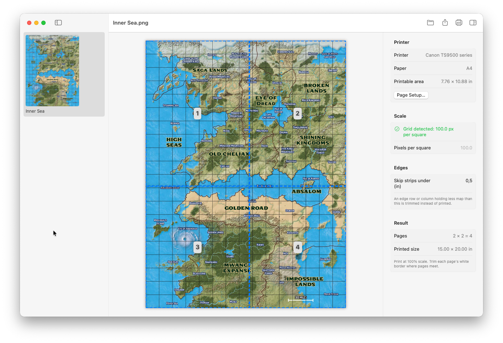

# Mapsmith

[](https://github.com/scooper4711/mapsmith/actions/workflows/ci.yml)
[](https://sonarcloud.io/summary/new_code?id=scooper4711_mapsmith)
[](https://sonarcloud.io/summary/new_code?id=scooper4711_mapsmith)
[](https://github.com/scooper4711/mapsmith/releases)
[](https://github.com/scooper4711/mapsmith/releases)
[](#requirements)
[](./LICENSE)

Have you tried printing a Flip-Mat PDF or an adventure's map at home? The map is far bigger than a sheet of
paper, and printing it "to fit" shrinks the squares until your miniatures no longer fit them.

Mapsmith is a Mac app that prints battle maps at true scale, one grid square per inch, on ordinary printer
paper. It finds the map's grid, splits the map into pages that fit your printer's printable area at exactly
one inch per square, and prints them, ready to trim and tape together.

It is free and open source, and it works with any PDF or image you open; it contains no maps of its own.



*Paizo's map of the Inner Sea with a square grid drawn over it, detected at 100 pixels per square and split
into four A4 pages at one inch per square (see [Sample map](#sample-map)).*

## Features

- **Open** a PDF or any image (⌘O, drag it onto the window, or *Open With* in Finder). For a PDF, every
  large image in the document is shown as a thumbnail. Each file opens in its own window, and
  **File › Open Recent** lists the latest ones. Images dragged straight out of another app, such as a map
  from [Pluck](https://github.com/scooper4711/pluck), can be dropped too.
- **Open from Scrollkeeper** (⇧⌘O): type part of a map's name to search the Flip-Mats, Flip-Tiles and other
  maps you own on paizo.com, as listed by [Scrollkeeper](https://github.com/scooper4711/scrollkeeper)
  (1.2 or later). Pick one and Scrollkeeper downloads it, if it is not on disk already, and opens it here.
  Mapsmith never signs in to Paizo itself.
- **Select** a map: its grid is detected and it is split into pages that fit the printable area of the
  current printer and paper (**File › Page Setup…**). Edge strips thinner than 0.5 in are trimmed rather
  than printed on their own pages, and the map is turned 90° when that uses fewer pages.
- **Print** the pages directly (⌘P), or **Export** them as a PDF (⌘E).

Print at 100% scale. Each page keeps the printer's non-printable margin blank; trim that border where pages
meet.

### How the scale is found

Grid detection sums edge strength along every row and column of the map and finds the repeat distance by
autocorrelation. If no grid is found, the app falls back to the PDF's own page scale or the image's DPI
metadata, and you can always type the pixels per grid square yourself in the inspector.

## Requirements

macOS 15 or later.

## Installing a release

Download the disk image from the [releases page](https://github.com/scooper4711/mapsmith/releases), open it
and drag Mapsmith to Applications.

The app is not notarized by Apple, so macOS blocks it the first time:

1. Open Mapsmith once. macOS says it cannot be opened; click Done.
2. Open System Settings › Privacy & Security and scroll down to the message about Mapsmith.
3. Click Open Anyway and confirm.

After that it opens normally.

## Tableside Toolkit

Mapsmith is part of the Tableside Toolkit, free Mac apps for running Pathfinder and Starfinder games in person;
Turnkeeper and Field Guide run on the iPad too. Like any good toolkit, each one grants a +1 item bonus to game
prep.

- [Scrollkeeper](https://github.com/scooper4711/scrollkeeper) keeps your Paizo library in order and downloads your
  purchases.
- [Pluck](https://github.com/scooper4711/pluck) gets the art, text and stat blocks out of a PDF.
- [Pawn Shop](https://github.com/scooper4711/pawn-shop) prints just the pawns you need, single-sided, from your
  pawn PDFs.
- **Mapsmith** prints battle maps at true scale on ordinary paper.
- [Turnkeeper](https://github.com/scooper4711/turnkeeper) builds encounters and runs initiative at the table, with
  the battle card of whoever's turn it is, on the iPad and the Mac.
- [Field Guide](https://github.com/scooper4711/field-guide) carries the Pathfinder and Starfinder compendium,
  offline, on the iPad and the Mac.

## Supporting the project

The app is free and always will be. If it saves you time and you would like to say thanks, you can leave a
tip on [Ko-fi](https://ko-fi.com/coop207627). A donation is entirely optional and unlocks nothing.

## Building

```sh
make app      # builds "build/Mapsmith.app"
make run      # builds and launches the app
make install  # builds the app and moves it to /Applications
make test     # runs the unit tests
make lint     # runs SwiftLint
make coverage # runs the tests and enforces the coverage threshold
make dmg      # packages the app into a disk image
make icon     # redraws Resources/AppIcon.icns
```

Building needs Xcode 16 or later (Swift 6 toolchain). The app is ad-hoc signed. Open `Package.swift` in Xcode
to run and debug it.

Tests that read real maps use PDFs in `TestData/`, which is not committed because the maps are copyrighted.
Copy or link your own Flip-Mat PDFs there to run them; they are skipped when the folder is empty.

The code is in two parts: `Sources/MapsmithCore` holds all the logic and is unit tested (grid detection,
finding maps in PDFs, planning and exporting pages), and `Sources/Mapsmith` is the SwiftUI app.

## Where things are stored

| What | Where |
|---|---|
| Images dropped from other apps | `~/Library/Caches/com.github.scooper4711.Mapsmith/Dropped Maps/` |
| Exported pages | wherever you save them, as PDF files |
| Maps opened from Scrollkeeper | Scrollkeeper's downloads folder; Mapsmith only reads Scrollkeeper's map list |

## Documentation

The requirements and design are in [`docs/specs`](docs/specs).

## Sample map

The map in the screenshot is Paizo's labeled world map of Golarion, published on the Paizo blog in
[Intro to Iblydos](https://paizo.com/blog/intro-to-iblydos) and used under Paizo's
[Community Use Policy](https://paizo.com/licenses/communityuse). A square grid is drawn over it so Mapsmith has
squares to find.

## License

Mapsmith is released under the [MIT license](LICENSE). It uses no third-party libraries.

## Paizo notices

Mapsmith uses trademarks and/or copyrights owned by Paizo Inc., used under Paizo's Community Use Policy
([paizo.com/licenses/communityuse](https://paizo.com/licenses/communityuse)). We are expressly prohibited from
charging you to use or access this content. Mapsmith is not published, endorsed, or specifically approved by
Paizo. For more information about Paizo Inc. and Paizo products, visit [paizo.com](https://paizo.com).

Pathfinder and Starfinder are registered trademarks and copyrights of Paizo Inc. Flip-Mat is a trademark of
Paizo Inc. The app itself contains no Paizo content; the sample map appears only in this README.

To report a problem or ask a question, open an [issue](https://github.com/scooper4711/mapsmith/issues).
